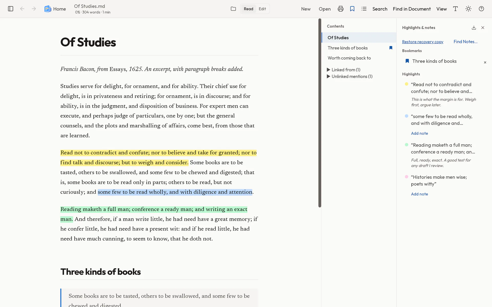
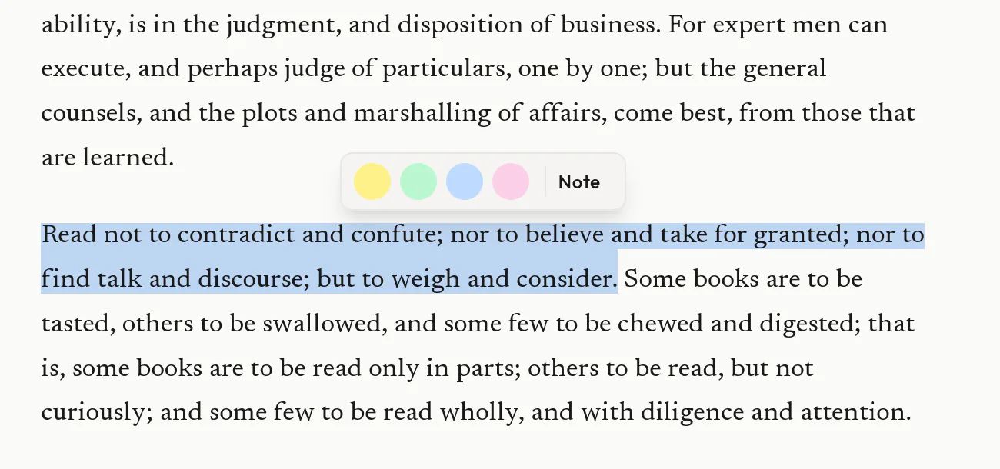
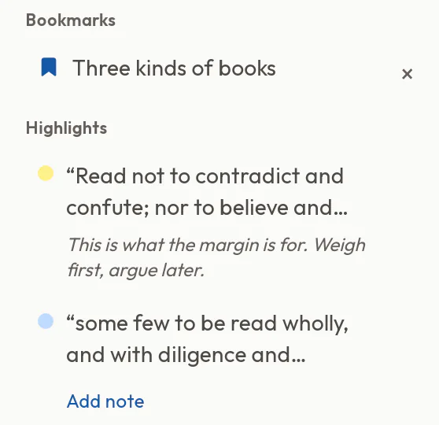
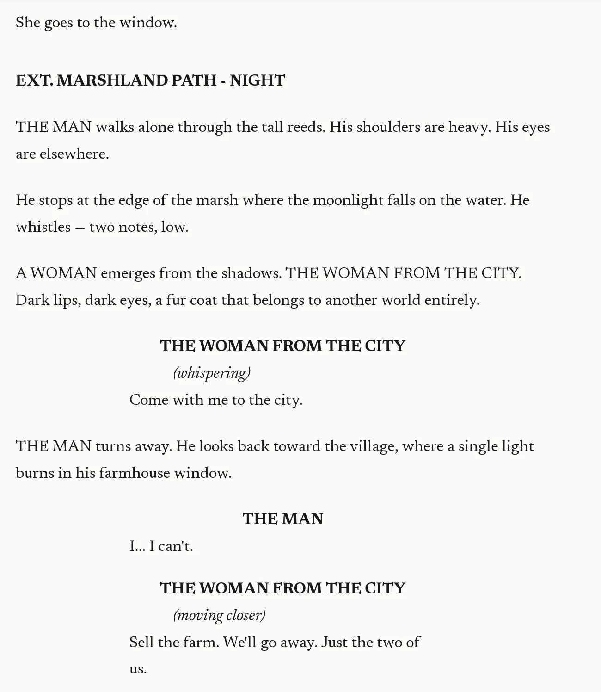

<p align="center">
  <a href="https://bindars.dev">
    
  </a>
</p>

<h1 align="center">Bindars</h1>

<p align="center">
  <strong>Read, highlight, and make notes on your own files.</strong><br>
  A free, open-source Markdown and Fountain reader for Mac and Linux.
</p>

<p align="center">
  <a href="https://github.com/tcraid0/Bindars/releases/download/v1.6.4/Bindars_1.6.4_aarch64.dmg">Mac download (Apple Silicon, macOS 15+)</a> ·
  <a href="https://github.com/tcraid0/Bindars/releases/latest">Linux releases (.deb, x86_64)</a><br>
  <a href="https://bindars.dev">Website</a> ·
  <a href="#documentation">Documentation</a>
</p>

<picture>
  <source media="(prefers-color-scheme: dark)" srcset="assets/readme/reading-dark.webp">
  
</picture>

*Bindars 1.6.1 on Linux.*

Open a Markdown document or Fountain screenplay, mark the passages you want to
come back to, and leave yourself a note. Reading and highlighting leave the
document unchanged; highlights, notes, and bookmarks are saved separately on
your computer. There's no account, telemetry, or automatic update check.

Supported files are `.md`, `.markdown`, and `.fountain`. Bindars doesn't import
Word or PDF documents.

## What it does

- **Reading settings.** Light, Sepia, Dark, and Midnight themes, plus adjustable
  fonts, text size, width, and spacing. Focus mode hides the surrounding controls.
- **Navigation and search.** Reopen where you left off, browse Recent, Drafts, or
  a folder of your own, and search across documents to jump straight to a passage.
- **Markdown rendering.** Tables, task lists, footnotes, syntax-highlighted code,
  Mermaid diagrams, KaTeX math, and frontmatter.
- **Editing.** Switch between Read and Edit without losing your place. Autosave
  writes to ordinary files. Print a document or save it as PDF.

## Highlights and notes

Select a passage and choose one of four highlight colors, or choose **Note** to
start writing. Your highlights, notes, and bookmarks collect in the side panel.
Choose a highlight to jump back to that passage, or export the list as Markdown.

<p align="center">
  <picture>
    <source media="(prefers-color-scheme: dark)" srcset="assets/readme/highlight-dark.webp">
    
  </picture>
  <picture>
    <source media="(prefers-color-scheme: dark)" srcset="assets/readme/notes-dark.webp">
    
  </picture>
</p>

To try it, choose **Try an Example…**, save a copy, and select a passage.
[How notes are saved and reconnected](docs/annotations.md).

## Fountain screenplays

Open a `.fountain` file in script layout. Use character focus to follow one
character, or jump between scenes from Contents. Highlights and notes work
here too, so you can export your notes when you're ready to revise.

<p align="center">
  <picture>
    <source media="(prefers-color-scheme: dark)" srcset="assets/readme/fountain-dark.png">
    
  </picture>
</p>

*Fountain example from [bindars.dev](https://bindars.dev).*

## Install

### macOS (Apple Silicon)

[Download Bindars 1.6.4 for Mac](https://github.com/tcraid0/Bindars/releases/download/v1.6.4/Bindars_1.6.4_aarch64.dmg),
open the DMG, and drag **Bindars** into **Applications**. Requires macOS 15 or
later; Intel Macs aren't supported. The app is signed with Developer ID and
notarized by Apple. Updates are manual.

Tested interactively on macOS 26.6.2; macOS 15 signed-app GUI testing remains
pending. See the [installation notes](docs/installation.md#macos-apple-silicon) for tested scope,
known limitations, checksums, and updating.

### Debian / Ubuntu / Linux Mint

Download the x86_64 `.deb` from the [latest release](https://github.com/tcraid0/Bindars/releases/latest),
then install it:

```bash
sudo apt install ./Bindars_*_amd64.deb
```

Each release is installed and launched on Ubuntu 22.04 before publication.
Debian 12 or newer and current Linux Mint releases are expected to work, but
don't receive the same automated test.

Windows releases are pending native testing and code signing. AppImage and Arch
package distribution are paused. Other Linux distributions can
[build from source](#build-from-source); those builds aren't official releases.

## Documentation

- [Using Bindars](docs/usage.md): navigation, search, keyboard shortcuts,
  interface zoom, macOS spelling, and rendering rules.
- [Highlights and notes](docs/annotations.md): annotation storage, file moves,
  exports, and recovery.
- [Saving your work](docs/recovery-and-privacy.md): autosave, Drafts, backups,
  and files left behind by interrupted saves.
- [Installation notes](docs/installation.md): platform support, checksums,
  updates, and known limitations.
- [Report a problem](https://github.com/tcraid0/Bindars/issues).

Raw HTML and remote images aren't rendered; see the
[rendering rules](docs/usage.md#rendering-rules) for supported local images and links.

## Build from source

Built with Tauri v2, React 19, TypeScript, and Tailwind CSS v4.
Use Node 24 LTS (`.nvmrc`); Node 22.12 or newer and Rust 1.90 or newer are required.

```bash
npm ci
npm run tauri -- build
```

Artifacts land in `src-tauri/target/release/bundle/`. Local builds may create
several platform-specific formats; see the [installation notes](docs/installation.md)
for the downloads the project currently publishes.

## Development

```bash
npm run tauri -- dev     # full app with hot reload
npm run dev             # frontend only (port 5173)
```

Run checks before committing:

```bash
npx tsc --noEmit                       # frontend types
cd src-tauri && cargo test --lib       # rust tests
cd .. && npm run test:workspace        # integration tests
```

## License

[MIT](LICENSE).
